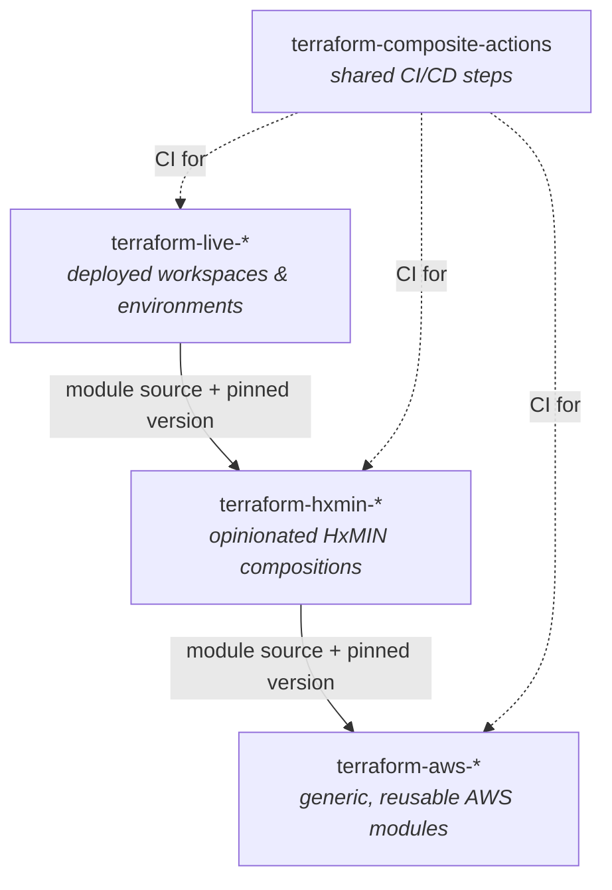
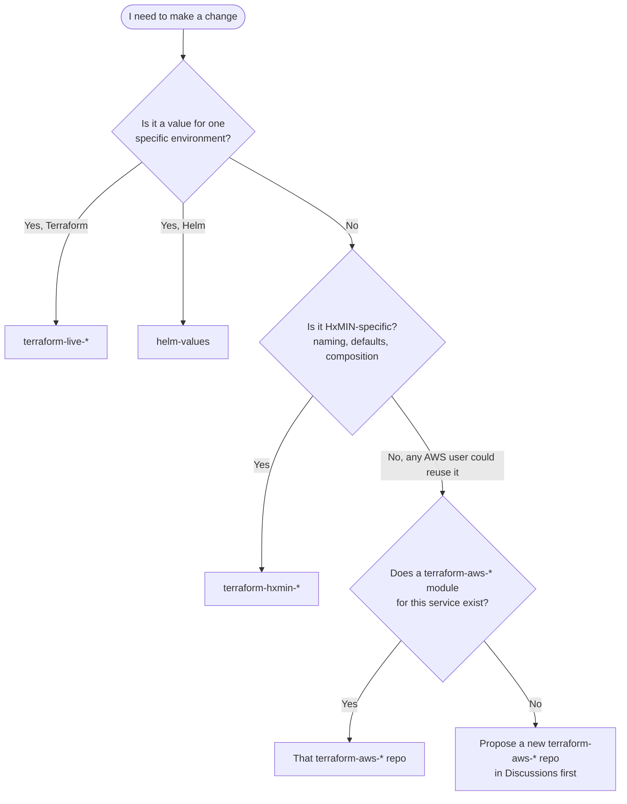

# Repository Guide

How the Hexagon Mining Infrastructure organisation is laid out, and which repository a
change belongs in.

- [Architecture: the three Terraform layers](#architecture-the-three-terraform-layers)
- [Which repository do I change?](#which-repository-do-i-change)
- [Repository catalogue](#repository-catalogue)
- [Naming conventions for new repositories](#naming-conventions-for-new-repositories)
- [Retired and experimental repositories](#retired-and-experimental-repositories)

---

## Architecture: the three Terraform layers

Infrastructure is built in three layers. Each layer only depends on the layer below it and
consumes it through a **pinned, published version** — never a git branch or local path.

| Layer | Prefix | Contains | Does **not** contain |
|---|---|---|---|
| Generic modules | `terraform-aws-*` | One AWS concern per repo, fully parameterised, no HxMIN assumptions | Environment values, account IDs, HxMIN naming |
| HxMIN modules | `terraform-hxmin-*` | Composition of generic modules with HxMIN naming, tagging and security defaults | Environment-specific values or state |
| Live | `terraform-live-*` | Workspace configuration, backend/state config, variable values per environment | Reusable resource logic |

Kubernetes workloads follow the same split: **`helm-charts`** holds the reusable chart,
**`helm-values`** holds per-environment values (dev / mgmt / stage …).

## Which repository do I change?

Rules of thumb:

- **Fix it at the lowest layer that owns the problem**, then bump the version in the layer above.
- A change that needs edits in several layers is **several PRs**, merged bottom-up
  (`terraform-aws-*` → release → `terraform-hxmin-*` → release → `terraform-live-*`).
- If you are copying resource blocks into a `terraform-live-*` repo, the logic belongs in a module.

## Repository catalogue

### Terraform – generic AWS modules (`terraform-aws-*`)

| Repository | Purpose |
|---|---|
| `terraform-aws-vpc` | VPC, subnets, routing, endpoints |
| `terraform-cidr-subnets` | Calculates subnet CIDRs under a prefix |
| `terraform-aws-ipam` | AWS IPAM pools and allocations |
| `terraform-aws-security-group` | Security groups and rules |
| `terraform-aws-route53` | Route 53 zones and records |
| `terraform-aws-iam` | IAM roles, policies, users, OIDC providers |
| `terraform-aws-secrets-manager` | Secrets Manager secrets and rotation |
| `terraform-aws-s3-bucket` | S3 buckets with secure defaults |
| `terraform-aws-dynamodb-table` | DynamoDB tables |
| `terraform-aws-rds` | RDS instances |
| `terraform-aws-rds-aurora` | Aurora clusters |
| `terraform-aws-rds-proxy` | RDS Proxy |
| `terraform-aws-ec2-instance` | EC2 instances |
| `terraform-aws-eks` | EKS clusters and node groups |
| `terraform-aws-eks-pod-identity` | EKS Pod Identity associations |
| `terraform-aws-eks-blueprints-addons` | Bundle of EKS add-ons (EKS Blueprints) |
| `terraform-aws-eks-blueprints-addon` | A single EKS add-on (Helm release + IRSA) |

### Terraform – HxMIN compositions (`terraform-hxmin-*`)

| Repository | Purpose |
|---|---|
| `terraform-hxmin-setup` | Foundation bootstrap: state backend, baseline IAM, management IPAM |
| `terraform-hxmin-eks-mgmt` | Management EKS cluster |
| `terraform-hxmin-eks-addons` | Kubernetes add-ons for the management cluster |
| `terraform-hxmin-eks-env` | Per-environment EKS clusters, VPC, Karpenter, cluster bootstrap |
| `terraform-hxmin-datalake` | Datalake (S3, Glue, IAM) |

### Terraform – live (`terraform-live-*`)

| Repository | Deploys |
|---|---|
| `terraform-live-setup` | `terraform-hxmin-setup` |
| `terraform-live-eks-mgmt` | `terraform-hxmin-eks-mgmt` |
| `terraform-live-eks-addons` | `terraform-hxmin-eks-addons` |
| `terraform-live-eks-env` | `terraform-hxmin-eks-env` |
| `terraform-live-datalake` | `terraform-hxmin-datalake` |

### Kubernetes, images and runtime

| Repository | Purpose |
|---|---|
| `helm-charts` | Reusable Helm charts |
| `helm-values` | Per-environment Helm values |
| `packer-bastion-images` | Packer builds for bastion AMIs |
| `dockerfiles` | Container image definitions |

### CI/CD and developer tooling

| Repository | Purpose |
|---|---|
| `terraform-composite-actions` | Composite GitHub Actions: pre-commit, trivy, sonar, terratest, semantic-version, publish, deploy, workspace-cleanup… |
| `actions--context` | Action exposing extra job context (job id, environment, deployment URL) |
| `python-hxmin-sdk` | CLI wrappers for common platform tasks |
| `dotfiles-example` | Reference developer workstation setup |
| `.github` | This repo: org profile, default community health files, best practices, reusable workflows |
| `.github-private` | Custom AI agents for development (members only) |
| `github-org-platform-governance` | Org governance, repo settings as code, platform standards |

### Documentation and knowledge

| Repository | Purpose |
|---|---|
| `wiki-infra-docs` | Platform documentation (CPDS, AISM) — **canonical home for docs** |
| `AIPD` | AI-powered documentation and knowledge retrieval |
| `wiki-ai-platform` | AI-augmented document assistant |
| `OAS-revamp` | Knowledge base for the OAS revamp under AISM |

## Naming conventions for new repositories

| Kind | Pattern | Example |
|---|---|---|
| Generic Terraform module | `terraform-aws-<service>` | `terraform-aws-elasticache` |
| HxMIN composition | `terraform-hxmin-<component>` | `terraform-hxmin-observability` |
| Live deployment | `terraform-live-<component>` (matches its `terraform-hxmin-*`) | `terraform-live-observability` |
| GitHub Action | `<purpose>-action` or inside `terraform-composite-actions` | — |
| Documentation | `wiki-<topic>` | — |

Before creating a repository:

1. Check this catalogue and search the org — extend an existing repo where possible.
2. Open a [Discussion](https://github.com/orgs/Hexagon-Mining-Infrastructure/discussions) (category *Ideas*) describing scope and owners.
3. Create it through `github-org-platform-governance` so settings, branch protection and team access are applied as code.
4. Add it to this guide in the same change.

## Retired and experimental repositories

| Repository | Status |
|---|---|
| `wiki-retired` | Retired — read-only, do not add content |
| `OAS-boilerplate-001` | Prototype / reference implementation |

> Keep this page current: if you add, rename, archive or repurpose a repository, update
> this guide in the same PR.
